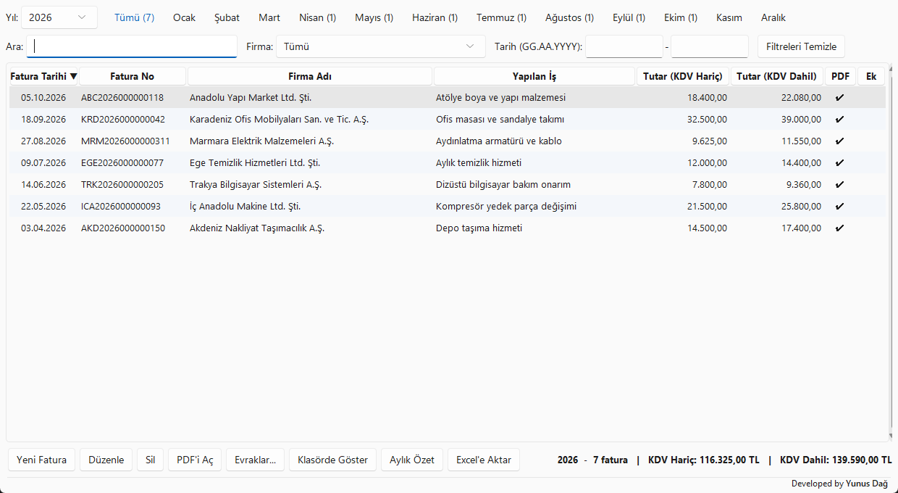
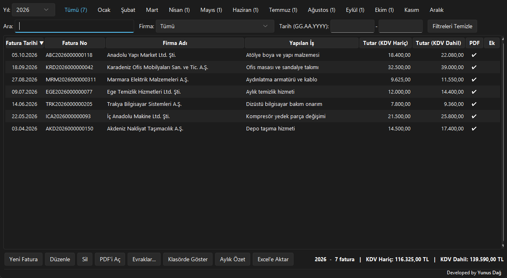

<div align="center">


# Alış Faturası Kayıt ve Takip

**Küçük ekipler için, ortak ağda çalışan, PDF faturayı okuyup formu kendisi dolduran masaüstü fatura kayıt uygulaması.**




</div>

> *English in short:* a desktop app for a small team to register and track purchase invoices on a shared network folder. It extracts invoice fields (date, number, supplier, tax ID, amounts) from PDFs, including multi-page scans, using a text-layer parser with a Windows OCR fallback. Python + tkinter + SQLite, packaged as a standalone `.exe`.

## Amaç

Alış faturalarını kaydetmek, her faturada firma / numara / tarih / tutarı elle yazma zahmetini ve hata riskini azaltmak ve bir faturaya ait evrakı tek yerde toplamak. Uygulama:

- faturayı **PDF'ten okuyup** alanları kendisi doldurur (sen kontrol edip kaydedersin),
- bir faturaya ait **tüm evrakı** (talep, yazı, irsaliye…) tek yerden açtırır,
- 4-5 kişilik ekibin **aynı veritabanını** ortak ağ klasöründen kullanmasını sağlar,
- ay ay **Excel'e düzenli tablo** olarak aktarır.

## Özellikler

| | |
|---|---|
| **Satır başına Gözat ile doldurma** | Yeni Kayıt formunda her satırın kendi Gözat'ı vardır; PDF, DOCX veya XLSX seçilir. Fatura PDF'inden tarih, fatura no, firma, KDV hariç tutar; Talep Formu PDF'inden talep no ve tarih; İhtiyaç Formu PDF'inde "Hizmetin/Malzemenin adı ve karakteristiği" başlığının altındaki açıklama işin adı olarak, Doğrudan Temin Onay Belgesi (DOCX) içinden DT numarası (ve istenirse işin adı) okunur. Fatura tarihi, no, firma ve tutar tek bir fatura PDF'inden birlikte doldurulur. Sonuçlar sarı işaretlenir, kullanıcı kontrol edip kaydeder; hiçbir şey onaysız kaydedilmez. |
| **Kategori** | Her kayıt bir kategoriye bağlanır (kamyon kiralama, akaryakıt, HGS vb.); Excel çıktısında kategori başına bir sayfa oluşur. |
| **Çok sayfalı belge desteği** | 10-20 sayfalık taramada **fatura sayfasını otomatik bulur** (sayfa puanlama); yanlışsa "Fatura sayfası" kutusuna `7` ya da `7-8` yazılır. |
| **Taranmış (resim) PDF'ler** | Windows'un yerleşik OCR motoru ile okunur; ek program kurmak gerekmez. |
| **Evrak yönetimi** | Faturaya talep, yazı, teklif, irsaliye gibi ekler bağlanır; faturaya çift tıklayınca hepsi listelenir, tek tuşla açılır. |
| **Arama ve filtre** | Yıl / ay / firma / tarih aralığı / serbest arama; aylık özet penceresi. |
| **Excel çıktısı** | Kategori başına sayfalı, biçimlendirilmiş `.xlsx`: gerçek tarih ve sayı hücreleri, toplam satırı, filtre, sabit başlık, yazdırma ayarı, tıklanabilir PDF bağlantıları. CSV de desteklenir. |
| **Mükerrer koruması** | Aynı firma + fatura no veya aynı PDF ikinci kez kaydedilemez. |
| **Modern arayüz** | Açık / Koyu / Mavi tema, zebra satırlar, uygulama ikonu. |

<div align="center">

</div>

## Mühendislik notları

Proje küçük görünse de birkaç gerçek sorunu bilinçli kararlarla çözüyor:

- **Tutarlar kuruş cinsinden `int` tutulur.** Kayan noktalı sayıdan kaynaklanan yuvarlama hatası olmaz; ayrıştırma `Decimal` ile yapılır, `1.234,56` / `1234.56` / `1.234` gibi farklı yazımlar doğru ayrılır.
- **Kendi PDF metin ayrıştırıcısı** (yalnızca standart kütüphane): içerik akışı, Flate/ASCII85 filtreleri, `ToUnicode` CMap ve sayfa konumuna göre satır birleştirme. PyMuPDF kuruluysa o kullanılır; yoksa yerleşik okuyucu devreye girer. Yani program **ek kütüphane olmadan da çalışır**.
- **Kademeli okuma:** PyMuPDF → yerleşik yazı katmanı okuyucu → Windows OCR. Her aşama bir öncekinin başaramadığını üstlenir; yazı katmanı olmayan sayfalar yalnızca gerektiğinde OCR'dan geçer.
- **Fatura sayfası tespiti:** Her sayfa "fatura ipuçları"na (fatura no, ETTN, vergiler dahil toplam…) göre puanlanır; talep ve yazı sayfaları alanlara karışmaz.
- **Ortak ağda SQLite:** Kilitlenme gibi hatalar kullanıcıya anlaşılır Türkçe mesajla gösterilir; yol UNC (`\\sunucu\paylasim`) olarak desteklenir.
- **Gerçek fatura düzenlerinden çıkan kurallar:** VKN (10 hane) ve TCKN (11 hane) ayrımı, kendi kurumun numarasını dışlama, firma adının satır sonunda bölünmesi (`… SAN. VE` / `TİC.LTD.ŞTİ`) gibi durumlar.
- **Arayüz donmaz:** Uzun PDF/OCR işleri ayrı iş parçacığında çalışır.

Kod tek dosyada (yaklaşık 2.500 satır) ve katmanlı: ayarlar → yardımcılar → veritabanı → PDF okuma → arayüz.

## Kurulum

### Kullanıcılar için (Python gerekmez)

1. [Releases](https://github.com/yunusdag-dev/faturatakip/releases/latest) bölümünden `FaturaTakip-...-windows.zip` dosyasını indirip kalıcı bir klasöre çıkarın.
2. `FaturaTakip.exe` için masaüstü kısayolu oluşturun.

> Exe tek başına çalışmaz; yanındaki `_internal` klasörüyle birlikte durmalıdır.

### Ortak ağda kurulum (ekip için)

1. Ortak bilgisayarda `C:\FaturaTakip\Program`, `Veri` ve `Evraklar` klasörlerini açın; programı `Program` içine koyun.
2. `C:\FaturaTakip` klasörünü paylaşıma açın; kullanıcılara **Okuma + Değiştirme** izni verin (SQLite yazma izni ister).
3. `Program\config.ini` içinde yolları UNC olarak yazın:
   ```ini
   [ayarlar]
   veritabani = \\SUNUCU-PC\FaturaTakip\Veri\fatura.db
   tarama_klasoru = \\SUNUCU-PC\FaturaTakip\Evraklar
   ```
4. Diğer bilgisayarlarda `\\SUNUCU-PC\FaturaTakip\Program\FaturaTakip.exe` için kısayol oluşturun.
5. **Güncelleme:** herkes programı kapattıktan sonra yeni dosyaları `Program`'a kopyalayın; `config.ini` ve `Veri`'ye dokunmayın.
6. `Veri\fatura.db` dosyasını düzenli yedekleyin.

Taranmış PDF'ler için Windows'ta **Türkçe OCR dil paketi** kurulu olmalıdır.

### Geliştiriciler için

```bash
git clone https://github.com/yunusdag-dev/faturatakip.git
cd faturatakip
pip install pymupdf openpyxl sv_ttk      # hepsi isteğe bağlı
python fatura_takip.py
```

Exe üretmek için bir kez `pip install pyinstaller` yapın, ardından [derle.bat](derle.bat) dosyasına çift tıklayın. Çıktı `dist\FaturaTakip\` içindedir.

## Ayarlar (`config.ini`)

Örnek: [config.ornek.ini](config.ornek.ini)

| Ayar | Açıklama |
|---|---|
| `veritabani` | Veritabanı yolu (ağ için UNC; sürücü harfi kullanmayın) |
| `tarama_klasoru` | PDF "Gözat" penceresinin ilk klasörü |
| `tema` | Açık / Koyu / Mavi |
| `kurum_anahtar` | Kendi kurumunuzun adından kelimeler; PDF'te alıcıyı firma sanmasın diye |
| `kurum_vkn` | Kendi kurumunuzun vergi numarası |

## Yol haritası

Ekipten gelen ihtiyaçlara göre planlanan, henüz **yapılmamış** fikirler:

- [ ] Ödeme durumu ve vade takibi (ödendi / ödenmedi, yaklaşan vade uyarısı)
- [ ] Firma bazlı yıllık özet
- [ ] Toplu PDF yükleme: bir klasördeki faturaları sırayla okutup tek ekranda kontrol etme
- [ ] Otomatik, tarihli veritabanı yedeği
- [ ] Değişiklik geçmişi (kim, neyi, ne zaman değiştirdi)
- [ ] Tutar tutarlılık uyarısı (KDV oranı ile uyuşmayan tutarlar)
- [ ] Sürükle-bırak ile PDF ekleme

## Bilinen sınırlamalar

- OCR ile okunan taramalarda hata payı vardır (örneğin `I` yerine `L`); sarı işaretli alanlar mutlaka kontrol edilmelidir.
- Veritabanı tek bir SQLite dosyasıdır; bu ölçekte (4-5 kullanıcı, kablolu ağ) yeterlidir, çok kullanıcılı/uzak erişim için uygun değildir.
- Dosyalar kopyalanmaz, yalnızca konumları kaydedilir; evraklar ekibin erişebildiği ortak klasörde durmalıdır.
- Yalnızca Windows'ta tam çalışır (OCR ve dosya açma işlevleri Windows'a bağlıdır).

## Lisans

Kaynak kod **MIT lisanslıdır** ([LICENSE](LICENSE)): kurumlar dahil kullanabilir, değiştirebilir ve dağıtabilirsiniz.
Derlenmiş pakette AGPL lisanslı PyMuPDF bulunduğundan, **dağıtım** için bileşen lisanslarına [THIRD_PARTY_NOTICES.md](THIRD_PARTY_NOTICES.md) dosyasından bakın. Dahili kullanım kısıtlanmaz.

## Gizlilik

`fatura.db`, `config.ini` ve fatura PDF'leri `.gitignore` ile repo dışında tutulur. Bu depodaki ekran görüntülerinde yer alan firma ve tutarlar **kurgusaldır**.

## Geliştirici

**Yunus Dağ** · [@yunusdag-dev](https://github.com/yunusdag-dev)
